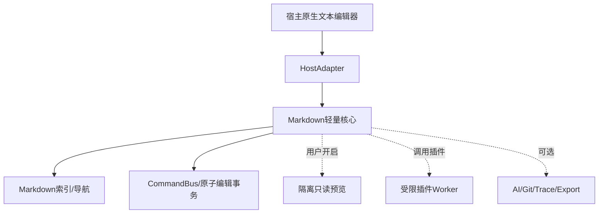

# BD-001 基本设计书（基本設計書）

| 项目 | 内容 |
|---|---|
| 适用基线 | REQ-LIDE-MD-001 v2.0 |
| 设计版本 | 1.0，2026-10-22 |
| 阶段 | 基本设计（外部设计/方式设计） |
| 设计状态 | 待宿主 API 与性能 POC 评审；非已实现产品 |
| 基本方针 | Sakura 风格轻量 IDE 的可选 Markdown 增强，不替换编辑引擎 |

## 1. 设计目标、范围与约束

1. 与宿主的文本模型共存，业务数据权威始终是原始 Markdown 文件。
2. 启动路径只扫描扩展元数据并决定是否激活基础能力；渲染、AI、Git 增强按需加载。
3. 提供8组以内默认工具入口、浮动工具和Slash命令，所有入口共享命令执行与撤销机制。
4. P0 为首期可交付边界，P1/P2 只设计兼容接口，不成为 P0 的依赖。
5. 保留 UTF-8/BOM/Shift-JIS、CRLF/LF、中文/日文 IME 组合输入与未知Markdown语法。
6. 架构部署仅示意 Windows 宿主优先的实现候选；不假定实际 Sakura Editor 有公开插件 API。

## 2. 设计裁决（Architecture Decision Records）

| ADR | 决策 | 原因 | 备选/约束 |
|---|---|---|---|
| ADR-01 | HostAdapter 复用宿主 Buffer/Undo/IO | 避免双缓冲与编码损坏 | 能力不足需 POC/特性降级 |
| ADR-02 | Markdown 源文件为唯一权威 | 确保Git/未知语法保真 | AST只是派生缓存 |
| ADR-03 | 启动期仅注册命令元数据 | 确保冷启动与内存低开销 | 插件代码惰性启动 |
| ADR-04 | 统一 CommandBus + EditTransaction | 保证跨UI入口行为一致 | 失败时原子回滚 |
| ADR-05 | 源码模式默认、分屏预览惰性 | 减少系统负担 | 即时渲染P1，WYSIWYG P2 |
| ADR-06 | 解析工作放在后台任务 | UI主线程只处理按需反馈 | 版本令牌防止过期结果覆盖 |
| ADR-07 | 插件分可信级别与隔离模式 | 避免未授权代码劫持宿主 | 无法沙箱时禁用高风险插件 |
| ADR-08 | 预览采用只读隔离载体 | 避免Markdown脚本影响宿主 | 可选WebView2；缺失退回源码 |
| ADR-09 | 解析器/渲染器封装为Port | 不将产品锁定在大型JS框架 | 首期需基准测评选择实现 |
| ADR-10 | 大文件压力自动降级 | 优先保证可编辑和可保存 | 阈值配置、告知用户 |
| ADR-11 | 文件/文档/Worktree复合身份 | 避免同名文档串数据 | 会话ID含工作区标识 |
| ADR-12 | 基本设计只定义契约，不凭空保证实际宿主接口存在 | 减少集成风险 | POC为实施前置门禁 |

## 3. 系统结构（システム構成）

架构源图：[architecture.mmd](diagrams/architecture.mmd)、[module_dependencies.mmd](diagrams/module_dependencies.mmd)、[deployment.mmd](diagrams/deployment.mmd)。



**常驻核心**：HostAdapter、SessionRegistry、CommandRegistry（元数据）、SourceRange索引的按需轻量缓存、ToolPalette配置。

**按需可卸载**：分屏预览、Mermaid/公式、插件执行体、AI/Git扩展、关系视图、导出。

### 3.1 模块职责与生命周期

| 模块 | 关键职责 | 生命周期 | 核心接口 | 失败退化 |
|---|---|---|---|---|
| HostAdapter | 对接宿主Buffer/Undo/IO/Selection | 随宿主 | IEditorHost | 禁用扩展，不影响原文 |
| SessionRegistry | 管理文档版本/工作区/模式 | 文件打开期间 | IDocumentSession | 回退源码 |
| MarkdownIndex | 按需解析AST/标题/引用 | 延迟初始化、版本缓存 | IStructureIndex | 普通文本定位 |
| CommandBus | 校验命令及提交补丁 | 调用时 | ICommandService | 拒绝事务 |
| ToolPalette | 分组/浮动/斜杠入口 | MD激活期间 | IToolHost | 使用宿主菜单和快捷键 |
| PreviewManager | Markdown->安全只读预览 | 用户打开期间 | IPreviewPort | 只保留源码 |
| PluginRegistry | 索引清单/权限/执行体 | 元数据懒读 | IPluginRegistry | 禁用单个插件 |
| OptionalAdapters | AI、Git、Trace、Export | 用户请求时 | IOptionalFeature | 禁用相关入口 |

## 4. 设计范围到需求映射

| 模块 | 名称 | 对应FR |
|---|---|---|
| HOST | 宿主编辑适配 | FR-001, FR-004 |
| SESSION | 文档会话与状态 | FR-002, FR-024, FR-029 |
| IO | 文件与编码保持 | FR-003 |
| TOOL | 工具导航与上下文 | FR-005, FR-006, FR-008, FR-009, FR-010, FR-013 |
| COMMAND | 命令事务与Slash | FR-007, FR-011, FR-012, FR-014, FR-015, FR-016, FR-017, FR-020, FR-023 |
| TABLE | 表格结构化操作 | FR-018 |
| ASSET | 图片资源管理 | FR-019 |
| PREVIEW | 按需预览与图形渲染 | FR-021, FR-022, FR-025, FR-026, FR-027 |
| STRUCT | Markdown结构索引与导航 | FR-030, FR-031, FR-032, FR-034 |
| LINT | 文档诊断 | FR-033 |
| PLUGIN | 插件注册/运行/隔离 | FR-035, FR-036, FR-037, FR-038, FR-039, FR-041 |
| SECURITY | 权限安全 | FR-040 |
| AI | AI受控提案 | FR-042, FR-043, FR-044 |
| GIT | Git兼容 | FR-045 |
| TRACE | 工程追踪与规则 | FR-046, FR-048 |
| EXPORT | 模板与导出 | FR-049 |
| OPTIONAL | 独立重型扩展 | FR-028, FR-047 |

## 5. 画面基本设计（画面基本設計）

| SCR | 名称 | 初始布局 | 触发/关闭 | 关键交互 |
|---|---|---|---|---|
| SCR-01 | 原生源码编辑 | 默认主画面，编辑区视觉优先 | 打开md | 文字、列表、链接、保存、撤销 |
| SCR-02 | 工具导航 | 单列32~40px图标，最多8组 | md自动出现/可隐藏 | 点击子组、拖动排序、重置 |
| SCR-03 | 大纲导航 | 非必需侧栏 | 用户打开/关闭 | 标题树、折叠、跳转 |
| SCR-04 | 分屏预览 | 右/下可调整只读面板 | 用户显式打开 | 同步位置、独立滚动、降级提示 |
| SCR-05 | 浮动/Slash命令 | 仅适用上下文显示 | 选区或 / | 键盘操作、Esc 退出、不抢IME焦点 |
| SCR-06 | 插件/权限提示 | 小型按需对话框 | 安装/首次调用 | 权限摘要、拒绝、禁用 |
| SCR-07 | AI差异审核 | P1 非默认页面 | AI提案 | 接受/拒绝/版本冲突 |

#### SCR-01 / SCR-02 文字线框

```text
┌──────────────────────────────────────────────────────────────┐
│ 宿主菜单  文件标签                                            │
├───┬────────────┬──────────────────────────────┬─────────────┤
│ T │ 大纲(可关) │ 原生Markdown代码编辑           │ 预览(默认关)│
│ o │ H1 H2 H3   │ # Heading                     │             │
│ o │            │ 正文与选区                   │             │
│ l │            │                              │             │
├───┴────────────┴──────────────────────────────┴─────────────┤
│ 行/列 | UTF-8/BOM | CRLF | MD SOURCE | 诊断                 │
└──────────────────────────────────────────────────────────────┘
```

- 所有附加面板可完全收起且恢复先前布局；不能让低频属性面板长期抢占编辑空间。
- 日文 IME 正在 composition 时不得弹起 Slash/浮动栏，不得劫持快捷键候选选择。
- 使用宿主字体、主题、DPI，不另设一套互相冲突的快捷键或标签页。

## 6. 外部设计/接口边界（外部インターフェース）

| IF | 对端 | 输入 | 输出 | 失败处理 | 影响要件 |
|---|---|---|---|---|---|
| IF-01 | Host Text Buffer | 文本快照/范围/版本 | EditTransaction结果/UndoID | 版本冲突拒绝 | FR-001/014/029 |
| IF-02 | Host Commands/UI | 命令ID/菜单/键盘 | 触发Context+结果 | 无能力则降级 | FR-004~012 |
| IF-03 | File/Encoding | 路径、编码、BOM、EOL | 文件状态/哈希 | 禁止隐式转换 | FR-003/019 |
| IF-04 | Markdown Parser Port | 快照+变更范围 | 节点、源码范围、错误 | 旧结果丢弃 | FR-030~034 |
| IF-05 | Preview Port | 版本化安全HTML+source map | 只读图像/错误 | 回到源码 | FR-022/025 |
| IF-06 | Plugin Worker Port | Manifest+请求+授权能力 | PatchProposal/结果 | 超时隔离与终止 | FR-035~040 |
| IF-07 | Optional AI Adapter | 最小上下文+授权确认 | 版本化PatchProposal | 不可外发/拒绝 | FR-042~044 |
| IF-08 | Git/Trace/Export | 文件及工作树ID | Diff/关系/导出文件 | 不污染原文 | FR-045~049 |

原则：CommandBus 不允许插件直接更改宿主 Buffer；权限检查与补丁校验在**宿主信任边界**内再次执行。

## 7. 逻辑数据设计

源图：[entity_model.mmd](diagrams/entity_model.mmd)。

| 数据实体 | 权威/派生 | 持久化 | 主键/边界 |
|---|---|---|---|
| DocumentSession | 派生运行态 | 不持久化正文 | sessionId=(workspaceId, hostBufferId, path) |
| DocumentText | 唯一正文权威 | 原 Markdown 文件 | 宿主 Buffer 与磁盘文件 |
| StructureNode | 派生索引 | 可丢弃缓存 | nodeId+version+byteRange |
| ToolDefinition/CommandDefinition | 元数据 | 内置+插件Manifest | namespace限定的唯一ID |
| PluginManifest | 插件签名/声明 | 插件包与配置 | pluginId+version |
| WorkspaceLayout | 用户设置 | 用户配置 JSON | workspaceProfileId |
| EditProposal | 暂态待审核 | 可选审计记录 | proposalId+expectedVersion |
| DocumentRelation | 可选派生 | sidecar JSON（P1） | workspaceId+source+target |

## 8. 文件安全与数据保真

- 打开/预览/切换不应触发文件写入；以字节hash+mtime+dirtyFlag验证。
- 编码：宿主输出原始编码信息；出现无法表示字符必须中断并展示显式转换选项。
- 对 Markdown 未识别部分使用**字节范围保护**，变更仅应用于用户目标范围；无需全篇重排。
- 同一 Worktree 的源引用使用工作区根相对解析，拒绝越界路径或需要用户授权。
- 保存冲突检测依据磁盘状态与基线版本；不能无提示覆盖外部修改。
- 远程资源默认受策略约束，预览默认禁用任意脚本；Mermaid只允许可信捆绑脚本在独立隔离文档执行。

## 9. 业务流程与状态

- 编辑事务：参见 [edit_sequence.mmd](diagrams/edit_sequence.mmd)。
- 插件生命周期：参见 [plugin_sequence.mmd](diagrams/plugin_sequence.mmd)。
- 预览异步流程：参见 [preview_sequence.mmd](diagrams/preview_sequence.mmd)。
- 模式状态：参见 [session_state.mmd](diagrams/session_state.mmd)。

### 9.1 模式状态机

PlainText ↔ MdSource ↔ MdSplit → MdImmediate(P1)；WYSIWYG(P2)为独立可选扩展。

触发预览失败、插件异常或高负载时可回退 MdSource，但不能失去当前未保存文本。

### 9.2 插件生命周期

ManifestInstalled → MetadataRegistered → PermissionPending → WorkerLoading → Active → Idle/Disabled/Uninstalled；WorkerCrash仅失败单次调用，释放后允许重试。不得默认在宿主启动时加载所有执行体。

## 10. 错误/告警与退化策略

| 代码 | 触发 | 用户表现 | 恢复/回滚 |
|---|---|---|---|
| E-CONFLICT | 文本版本与提案不一致 | 非阻塞冲突提示 | 重新生成提案 |
| E-ENCODING | 字符无法以原编码保存 | 显式选项 | 不写文件，用户选择转换 |
| E-PARSER | Markdown解析器失败 | 源码仍可输入 | 索引失效/按需重建 |
| E-PREVIEW | 预览或WebView不可用 | 仅关闭预览 | 源码不变 |
| E-PLUGIN | 插件退出/超时 | 工具失败 | Worker终止、注销资源 |
| E-PERMISSION | 文件/网络/进程越权 | 拒绝通知 | 无副作用 |
| E-FILE-RACE | 文件被外部修改 | 合并/放弃选择 | 禁止静默覆盖 |
| E-OVERLOAD | 资源预算超过阈值 | 自动建议仅源码 | 取消后台任务并降级 |

## 11. 非功能设计

测试阈值以 REQ 的 NFR-001~028 为准。P95使用同机、固定fixture、冷/热分离、至少30次重复采样；性能失败不得以隐藏异常或丢弃内容换取。

| 目标 | 基本设计措施 | 验证方法 |
|---|---|---|
| 纯文本冷启动影响 <=100ms P95 | 非md只读轻量注册，零WebView | 宿主裸机 vs 插件对照30轮 |
| 常驻增量 <=10MiB(初始目标) | 无常驻渲染库/插件worker | 进程树RSS/Private Bytes |
| 1MiB文件打开 <=1s P95 | 后台索引，快速源码显示 | 30轮冷/热加载 |
| 输入显示 <=50ms P95 | 阻止UI线程同步全解析 | 事件到绘制探针 |
| 预览首次打开 <=2s P95 | 基础HTML惰性初始化 | 30轮预览首开 |
| 大文件降级 | 限制渲染队列、取消过期任务 | 10/50MiB边界样本 |
| 非法脚本/插件权限 | CSP、sanitize、OS级受限worker | 越权与XSS场景 |

## 12. 优先级/迭代与前置条件

- **Stage 0：宿主能力 POC**。验证可拦截 EditTransaction、Undo、IME、原编码获取、嵌入UI面板、工作区ID、外部文件修改事件；若失败，变更ADR并重评FR。
- **Stage 1：P0**。源码/工具/结构索引/分屏基础预览/插件元数据+安全/数据保真，满足性能门禁。
- **Stage 2：P1**。可视表格、即时渲染、AI/Git/关系、导出、质量检查。
- **Stage 3：P2**。WYSIWYG、Node/Edge高级图形插件。

## 13. 基本设计审查要点

1. HostAdapter 是否真的能保证原子撤销、源编码保留？
2. WebView2、Mermaid、Math、Agent 是否不在普通编辑启动路径？
3. 插件隔离是在 OS 权限边界实现，还是仅逻辑层检查？后者不足以支撑高风险插件。
4. 对无法无损转换的Markdown/HTML是否明确降级？
5. 需求FR/NFR是否都有详细设计与测试用例映射？
6. 是否明确 P1/P2 不是 P0 发布硬依赖？

## 14. 未决问题

见 `04_评审与管理/Open_Items.md`。设计状态为**建议方案**，具体 API/进程沙箱/渲染器选型必须在 Stage 0 证据基础上批准。
