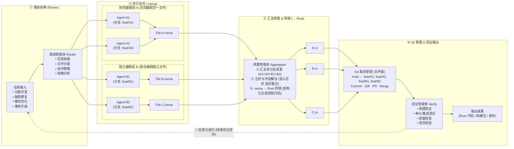

# IDE1.0 多智能体协同开发平台基本设计书（`.nema` 原生协作 × 统筹转换 × Git 版本管理）

**文档编号**: BD-AGENT-NEMA-2026-V3.0  
**制定组织**: IDE1.0 内核与多智能体架构委员会  
**基准版本**: v3.0  
**状态**: 承认済 (Baseline Locked)  
**关联设计**:
- [Web-Agent-Router-Requirements.md](../00_要件基线/Web-Agent-Router-Requirements.md)
- [Web-Agent-Router-Basic-Design.md](./Web-Agent-Router-Basic-Design.md)
- [DD-002_NEMA-Aggregator-Git-Verify-Pipeline.md](../02_详细设计/DD-002_NEMA-Aggregator-Git-Verify-Pipeline.md)

---

## 1. 架构愿景与六大技术支柱 (Architecture Vision & Six Pillars)

面对多智能体（Multi-Agent）大规模并行软件工程中的三大核心痛点——**上下文 Token 爆炸**、**同文件并发文本合并冲突**以及**AI 生成代码缺乏确定性门禁与可追溯版本管理**，IDE1.0 构建了以 **`.nema` 原生协作 × 统筹转换 (`Aggregator`) × 文件级 Git 版本管理 × 自动验证闭环 (`Verify`)** 为核心的四阶段多智能体协同开发平台。

| 支柱编号 | 核心支柱 | 架构职责与工程收益 |
|:---|:---|:---|
| **Pillar 1** | **`.nema` 协同格式** *(多人协作 · 低 Token)* | 采用 `crates/nema-codec` 提供的 `Table (\t\N)`、`5W1H (\t?N)`、`Graph (\t>N)` 三维结构化语义域与 `\t$N` 共享词典 + RLE 传输编码（`.nemat`），将多 Agent 协作期间的上下文 Token 消耗降低 45%～70%，并以显式域/记录边界取代脆弱的自由文本行号。 |
| **Pillar 2** | **Git 分支策略** *(多分支并行 · 文件级)* | 围绕受保护稳定主干 `main`，为每个 Agent 动态签发文件级/特性级隔离分支（`feat/A1`、`feat/A2`、`feat/B1`、`feat/B2`），完整支持 `Commit 提交`、`Diff 差异`、`PR 合并请求` 与 `Merge 合并`。 |
| **Pillar 3** | **汇总统筹 (`Aggregator`)** *(多分支整合 · 冲突处理)* | 统筹智能体跨分支拉取 `A1 + A2 + B1 + B2` 的 `.nema` 变更，基于域 ID、记录主键、5W1H 轴与 Graph 独立 Edge ID 执行 AST 级三方语义合并与冲突消解。 |
| **Pillar 4** | **格式转换 (`.nema → Rust`)** *(结构化生成常规代码)* | 将合并收敛后的权威 `.nema` 语义规约（`File A.nema`、`File B.nema`、`File C.nema`）确定性降维（Lowering）生成为常规 Rust 源码（`A.rs`、`B.rs`、`C.rs`），严格遵守 `IDE-08` 源码保护不变量。 |
| **Pillar 5** | **自动验证 (`Verify`)** *(构建 · 测试 · 质量)* | 验证智能体在隔离沙箱中对生成的 `A.rs / B.rs / C.rs` 执行构建验证、单元/集成测试、质量检查与安全规范校验，签发 `AcceptanceCertificate`。 |
| **Pillar 6** | **可发布产物 & 反馈闭环** *(源码 · 包 · 部署 · 持续优化)* | 验证通过后合入 `main` 并输出可发布产物（Rust 代码 / 构建包 / 部署镜像）；若验证失败，则通过 SourceMap 反向定位至 `.nema` 责任分支，沿 **反馈与迭代闭环** 自动回流至路由智能体。 |

---

## 2. 四阶段端到端流水线拓扑 (Four-Stage Pipeline Topology)

---

## 3. 各阶段职责边界与协作模型 (Stage Boundaries & Collaboration Models)

### 3.1 阶段 ①：任务输入与路由智能体 (`Router Agent`)
1. **多源任务标准化 (`TaskIngestion`)**：
   - 接收四类标准研发输入：**功能开发 (`FeatureDev`)**、**缺陷修复 (`BugFix`)**、**模块优化 (`ModuleOpt`)**、**重构升级 (`RefactorUpgrade`)**。
2. **四维路由决策**：
   - **任务拆解 (`Task Decomposition`)**：将高层需求拆解为带有明确前置/后置条件的 `SemanticSubTask`。
   - **文件分配 (`File Allocation`)**：识别目标 `.nema` 蓝图文件（如 `File A.nema`、`File B.nema`、`File C.nema`）与目标产物（`A.rs`、`B.rs`、`C.rs`）的映射关系。
   - **协作策略编组 (`Collaboration Strategy`)**：
     - **协同编辑组 A（同文件多分支协作）**：当 `Agent A1` 与 `Agent A2` 需要共同设计或修改同一逻辑模块 `File A.nema` 时，Router 将 `File A.nema` 内部的语义域（`\t\1` 数据表、`\t?2` 5W1H 规约、`\t>3` 调用图）或记录区间划分为非重叠的 `GuidanceZone`，分别绑定至分支 `feat/A1` 与 `feat/A2`。
     - **独立编辑组 B（跨文件独立分支协作）**：当 `Agent B1` 与 `Agent B2` 负责正交模块 `File B.nema` 与 `File C.nema` 时，Router 分配独立分支 `feat/B1` 与 `feat/B2`，并预先冻结跨文件调用边契约（`B>EdgeId>C`）。
   - **依赖分析 (`Dependency DAG`)**：计算任务拓扑序，签发带有 `Epoch` 与单调递增 `FencingToken` 的租约凭据。

### 3.2 阶段 ②：`.nema` 原生并行协作 (`Parallel .nema Collaboration`)
1. **低 Token 传输与持久化权威分离**：
   - Agent 间通信、上下文检索与 Prompt 注入采用 `.nemat` 压缩流（共享字典 `\t$N` + `^N` 引用 + RLE）；分支工作区持久化采用规范化原生 `.nema` 格式，每次写入均通过 `StandardNemaCodec` 执行字节级往返校验。
2. **协同编辑组 A（`Agent A1 @ feat/A1` + `Agent A2 @ feat/A2` → `File A.nema`）**：
   - 基于 `AnchorOffsetTable` 与 `NemaDomain/Record` 稳定身份标识，允许 `A1` 与 `A2` 并行演进同一 `.nema` 文件的不同域或不同记录行，彻底规避传统源码因括号、缩进或 import 顺序变化引发的伪冲突。
3. **独立编辑组 B（`Agent B1 @ feat/B1 → File B.nema`，`Agent B2 @ feat/B2 → File C.nema`）**：
   - 各自在独立文件级分支上全速推进，互不阻塞。

### 3.3 阶段 ③：统筹智能体 (`Aggregator Agent`) 与 `.nema → Rust` 转换
1. **① 汇总多分支变更 (`A1 + A2 + B1 + B2`)**：
   - 收集所有已完成并通过单分支语法校验的 `.nema` 分支快照（`feat/A1`、`feat/A2`、`feat/B1`、`feat/B2`）。
2. **② 合并与冲突解决（语义合并 · 差异整合）**：
   - 对同文件分支 `feat/A1` 与 `feat/A2` 上的 `File A.nema` 执行结构化三方合并（`NemaThreeWayMerge`）：
     - 自动统一合并 `\t$N` 共享词典并重映射 `^N` 索引；
     - 按 `DomainId`、表头 `\\ `、记录主键与 Graph 独立 `EdgeId` 合并各域内容；
     - 若存在同一单元格或同一 `EdgeId` 的并发竞争修改，则依据 `UpfrontPlan` 契约优先级或触发局部仲裁解决冲突。
3. **③ `.nema → Rust` 结构化转换（生成 `A.rs`、`B.rs`、`C.rs`）**：
   - 将收敛后的 `File A.nema`、`File B.nema`、`File C.nema` 降维生成为标准 Rust 源码文件 `A.rs`、`B.rs`、`C.rs`，同时生成双向 `NemaRustSourceMap`（记录 `.nema` 域/行 Span 到 `.rs` `SemanticUnit` 的精确映射）。
   - 严格落实 `IDE-08`：`.nema` 协同文件与 `.rs` 源码文件各司其职，绝不直接把 `.rs` 当作纯文本覆写为 `.nema`。

### 3.4 阶段 ④：文件级 Git 版本管理、验证智能体 (`Verify Agent`) 与反馈闭环
1. **Git 版本管理（文件级分支模型）**：
   - 维护清晰的分支演进拓扑：`main`（稳定基线） ← `feat/A1`、`feat/A2`、`feat/B1`、`feat/B2`。
   - 提供标准化的 `Commit 提交`、`Diff 差异`（`.nema` 拓扑/表格对比 + `.rs` 代码对比）、`PR 合并请求` 与 `Merge 合并` 流水线。
2. **验证智能体 (`Verify Agent`) 四维验证门禁**：
   - **构建验证**：执行 `cargo check` / `cargo build`，验证 `A.rs`、`B.rs`、`C.rs` 跨模块类型与生命周期完整性。
   - **单元 / 集成测试**：执行 `cargo test`，验证业务逻辑与边界条件。
   - **质量检查**：执行 `cargo clippy`、格式化检查与复杂度审计。
   - **规范校验**：验证 `#![forbid(unsafe_code)]`、`SecretRef` 零密钥泄漏、`.nema` 往返无损性及系统不变量（`INV-01` ~ `INV-06`）。
3. **输出成果与 🔄 反馈与迭代闭环**：
   - **验证通过**：签发 `AcceptanceCertificate`，执行原子 `Merge` 合入 `main`，产出可发布成果（Rust 代码 / 构建包 / 发布产物）。
   - **验证未通过**：`Verify Agent` 利用 `NemaRustSourceMap` 将 `rustc` / `cargo test` 报错位置逆向映射回对应的 `.nema` 域、记录与责任分支（例如定位到 `File A.nema` 中由 `feat/A2` 修改的 Graph 边或 5W1H 约束），封装为结构化反馈单回流至阶段 ① `Router Agent`，驱动下一轮迭代闭环。

---

## 4. 异构智能体独立模型、Effort 与思考模式架构 (Per-Agent Heterogeneous Model, Effort & Thinking Profiles)

在四阶段流水线中，不同智能体的认知负荷、延迟敏感度与工具调用深度截然不同（例如 `Router` 与 `Aggregator` 需要深度全局推理与冲突裁决，而并行编辑组 `Agent A1/A2/B1/B2` 更追求高吞吐与低延迟结构化生成）。因此，系统支持**每个智能体独立配置底层大模型 (`model`)、推理强度 (`effort`)、思考模式 (`thinking_mode` + `thinking_budget_tokens`)、采样参数及独立供应商端点 (`base_url` / `SecretRef`)**。

### 4.1 智能体角色画像与差异化推荐配置矩阵

| 阶段 | 智能体标识 (`agent_id`) | 角色与分支绑定 | 推荐模型层级 | 推荐推理强度 (`effort`) | 推荐思考模式 (`thinking_mode`) | 思考预算 (`budget_tokens`) | 设计理由与权衡 |
|:---|:---|:---|:---|:---|:---|:---|:---|
| **① 路由拆解** | `router` | **路由智能体 (Router)** | 旗舰架构模型 *(Claude Opus 4.6 / GPT-5 / Gemini 2.5 Pro)* | `high` / `xhigh` | `enabled` *(显式深度思考链)* | `16,384` | 负责全局任务拆解、依赖 DAG 拓扑分析与协同/独立编组决策，一步规划失误会放大至下游所有分支。 |
| **② 并行协作** | `agent-a1` | **协同编辑组 A · Agent A1** *(分支 `feat/A1` → `File A.nema`)* | 高速编码模型 *(Claude Sonnet 4.6 / GPT-5-mini)* | `medium` | `auto` / `enabled` | `4,096` | 同文件多域协同需严格遵守 `GuidanceZone` 锚点边界与 `.nema` 语法，中等思考预算兼顾并发吞吐与边界精度。 |
| **② 并行协作** | `agent-a2` | **协同编辑组 A · Agent A2** *(分支 `feat/A2` → `File A.nema`)* | 高速编码模型 *(Claude Sonnet 4.6 / DeepSeek-R1)* | `medium` | `auto` / `enabled` | `4,096` | 与 `A1` 并行演进同一 `.nema` 文件的不同语义域（如 Graph 拓扑边），支持与 `A1` 使用异构厂商模型交叉互补。 |
| **② 并行协作** | `agent-b1` | **独立编辑组 B · Agent B1** *(分支 `feat/B1` → `File B.nema`)* | 高吞吐低延迟模型 *(Gemini 2.5 Flash / Sonnet / 本地 vLLM)* | `low` / `medium` | `auto` / `disabled` | `0` ~ `2,048` | 独占独立文件 `File B.nema`，无同文件写集争用，可关闭或自适应思考以获得极致并发生成速度与最低 Token 成本。 |
| **② 并行协作** | `agent-b2` | **独立编辑组 B · Agent B2** *(分支 `feat/B2` → `File C.nema`)* | 高吞吐低延迟模型 *(Gemini 2.5 Flash / GPT-5-mini)* | `low` / `medium` | `auto` / `disabled` | `0` ~ `2,048` | 独占独立文件 `File C.nema`，与 `B1` 完全并行推进。 |
| **③ 汇总统筹** | `aggregator` | **统筹智能体 (Aggregator)** *(`A1+A2+B1+B2` 合并 + `.nema → Rust`)* | 旗舰推理与代码生成模型 *(Claude Opus 4.6 / o3-pro / GPT-5)* | `xhigh` / `max` | `interleaved` *(工具交错思考模式)* | `32,768` | 需同时处理多分支语义冲突消解与 `.nema → A.rs/B.rs/C.rs` 确定性类型降维，交错思考可在每次 AST 校验之间深度推理。 |
| **④ 验证输出** | `verify` | **验证智能体 (Verify)** *(构建/测试/质量/规范 + 逆向回流)* | 诊断分析与工具模型 *(Claude Sonnet 4.6 / GPT-5)* | `high` | `interleaved` *(工具交错思考模式)* | `8,192` | 在执行 `cargo build`、`cargo test`、`clippy` 与反查 `NemaRustSourceMap` 多步工具调用之间交错推理，精准定位根因分支。 |

### 4.2 三级配置继承与回退机制 (`Fallback & Inheritance Hierarchy`)
1. **实例级独立配置 (`Instance Override`)**：针对单个智能体（如 `aggregator` 或 `agent-a1`）显式指定的 `base_url`、`model`、`effort`、`thinking_mode`、`thinking_budget_tokens`、`temperature`。
2. **角色组默认配置 (`Role Group Default`)**：协同编辑组 A 或独立编辑组 B 的组级默认参数。
3. **全局默认配置 (`Global Baseline`)**：当某智能体的字段留空或设为 `inherit` 时，自动回退继承「首选项 → AI」中的全局默认模型、端点、Key 与 Effort，确保零配置即可开箱即用，同时支持按需精细化调优。

---

## 5. 核心系统不变量 (System Invariants)

| 编号 | 不变量名称 | 形式化约束描述 |
|:---|:---|:---|
| **INV-01** | **显式状态与租约单调性** | 任何 Agent 对 `.nema` 分支或 `.rs` 产物的写操作必须持有有效 `(epoch, fencing_token)`；过期 Epoch 的计算结果一律丢弃。 |
| **INV-02** | **`.nema` 往返字节恒等** | 任意分支上的 `.nema` ⇄ `.nemat` 转换必须满足 `decode(encode(S)) == S`，且未解码校验的 `.nemat` 严禁进入渲染器或代码生成器。 |
| **INV-03** | **协同与源码双轨隔离 (`IDE-08`)** | `.nema` 是多智能体高密度协同规约层，`*.rs` 是目标编译产物层；严禁在编辑器或流水线中将 `*.rs` 原地破坏性覆盖为 `.nema` 文本。 |
| **INV-04** | **同文件协同零静默覆盖** | 协同编辑组 A（`feat/A1` + `feat/A2`）合并 `File A.nema` 时，若写足迹相交且语义不等价，必须显式进入 `Aggregator` 冲突消解状态机，禁止后写覆盖先写。 |
| **INV-05** | **未验证不入主干 (`Verify Gate`)** | 未获得 `Verify Agent` 签发的 `AcceptanceCertificate`（含构建、测试、质量、规范四项全绿证明）的任何 PR 严禁 Merge 进入 `main` 分支。 |
| **INV-06** | **反馈闭环可逆可追溯** | 每个生成的 `.rs` 符号必须通过 `NemaRustSourceMap` 双向关联至 `.nema` 的 `(domain_id, record_idx)` 与 Git 分支 `feat/*`，确保验证失败可精确回流定位。 |
| **INV-07** | **智能体配置隔离与凭据安全** | 每个智能体的 `AgentModelProfile` 独立序列化与审计；API Key 仅以 `SecretRef` 形式引用，严禁明文出现在 `.nema` 词典、Git Commit Trailer 或前端日志中。 |
| **INV-08** | **思考预算与输出上限恒成立** | 当智能体开启 `Enabled` 或 `Interleaved` 思考模式时，系统强制满足 `max_output_tokens >= thinking_budget_tokens + 4096`，并自动剥离与扩展思考冲突的自定义 `temperature`。 |
| **INV-09** | **反馈闭环有限终止 (`Circuit Breaker`)** | 阶段 ④ $\to$ 阶段 ① 的自动反馈闭环受 `FeedbackLoopGuard` 硬性约束（默认最多 3 轮、单流水线最大 Token 预算上限、连续重复错误指纹立即熔断），严禁无界自激振荡。 |

---

## 6. 架构自审与故障收敛矩阵 (Architecture Self-Review & Fault-Containment Matrix)

依据系统工程自审准则（`invariants_hold`、`failure_modes_covered`、`races_addressed`、`data_safe`、`operable_by_humans`、`minimal_for_intent`），对四阶段流水线的边界竞态与异常模式做如下防御闭环设计：

| 自审维度 | 潜在故障 / 竞态场景 | 架构级遏制与自愈机制 |
|:---|:---|:---|
| **1. 跨阶段 Epoch 竞态** *(Races Addressed)* | `Agent A1` 已完成提交，`Router` 因需求变更触发新 `Epoch #N+1`，而旧 `Aggregator (Epoch #N)` 仍在后台执行合并。 | **跨阶段 Epoch 屏障 (`Epoch Barrier`)**：所有分支 Commit Trailer、合并请求与验证报告均绑定 `(pipeline_run_id, epoch, base_main_oid)`；`Aggregator` 与 `FileCommitCoordinator` 拒绝任何低于当前最新 `epoch` 的提交（返回 `412 FENCING_STALE`）。 |
| **2. 人工修改 `.rs` 漂移覆盖** *(Data Safe / No Silent Corruption)* | 开发者在 `main` 分支直接手改了 `A.rs` 的某函数，下一轮 `Aggregator` 从 `File A.nema` 重新生成 `A.rs` 时可能冲掉人工修改。 | **双向 AST 漂移检测守卫 (`NemaRustDriftGuard`)**：`NemaRustSourceMap` 记录上次生成的 `rust_ast_hash`；重生成前若检测到 `main` 上 `A.rs` 的符号哈希偏离上次生成值，立即阻断盲目覆写，标记 `HUMAN_EDIT_DRIFT` 并将差异提升回 `File A.nema` 供确认。 |
| **3. 异构模型思考参数不兼容** *(Failure Modes Covered)* | 用户为某 Agent 配置了 `Interleaved` 思考或 `xhigh` Effort，但所填第三方兼容端点不支持该参数并返回 `400 Bad Request`。 | **能力自适应降级状态机 (`ThinkingMode::downgrade`)**：协议层首先在本地保证 `max_tokens > budget_tokens` 且剥离冲突 `temperature`；若远端仍拒绝思考参数，按 `Interleaved → Enabled → Auto → Disabled` 确定性降级重试一次，并缓存该端点能力位。 |
| **4. 验证失败死循环风暴** *(Finite Lifecycle / No Unbounded Growth)* | `Verify Agent` 运行 `cargo test` 失败后回流 `Router`，但 Agent 反复生成相同错误代码，导致无限循环消耗 Token。 | **闭环熔断器 (`FeedbackLoopGuard`)**：内置三重门限：① 最大迭代轮数 `max_rounds = 3`；② 累计 Token 预算上限；③ 错误指纹去重集合 `seen_error_fingerprints`（连续两轮出现同一 `(error_code, symbol_path)` 立即熔断并转交人工审查面板）。 |
| **5. 同文件词典下标碰撞** *(Consistency)* | `feat/A1` 定义 `^0=Gateway`，`feat/A2` 定义 `^0=AuthService`，合并 `File A.nema` 时直接拼接会导致 `^0` 语义错乱。 | **词典解引用重排 (`Dictionary Unification`)**：`Aggregator` 先将各分支的 `AtomChunk::DictionaryRef` 还原为字面值语义，构建全局统一词频表后重新分配 `\t$N` 与 `^N` 编号，再经 `StandardNemaCodec` 往返校验。 |
| **6. 人类可操作与可干预性** *(Operable by Humans)* | 全自动流水线黑盒运行，开发者无法中途微调某个智能体的模型或介入某条 `.nema` 拓扑边。 | **透明可视化与即时覆盖**：Web / Tauri / `ide-fast` 提供实时 `.nema`（`Table / 5W1H / Graph`）双栏编辑与多 AI 协同看板，随时可单步撤销（`Ctrl+Z`）、调整任意智能体的 `model / effort / thinking_mode` 或手动回滚到 `Certified Base`。 |

