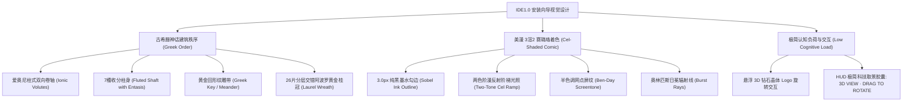

# IDE1.0 3D 卡通渲染美漫古希腊神殿安装向导基本设计书

**文档编号**: BD-INSTALLER-3D-GREEK-2026-V1.0  
**制定组织**: IDE1.0 交互体验与视觉工程委员会  
**基准版本**: v1.0  
**状态**: 承认済 (Baseline Locked)  
**关联设计**:
- [BD-001_基本设计书.md](./BD-001_基本设计书.md)
- [DD-004_3D-Greek-Temple-Shader-Pipeline.md](../02_详细设计/DD-004_3D-Greek-Temple-Shader-Pipeline.md)

---

## 1. 设计愿景与美学定位 (Aesthetic Vision & Positioning)

传统的 Windows 安装程序界面（如标准向导、单调进度条与灰阶背景）往往陈旧呆板，无法传递现代高性能开发工具的技术魅力。
IDE1.0 彻底抛弃传统原生向导设计，构建以 **Three.js WebGL / WebGPU 自绘 3D 卡通渲染美漫风格（3D-to-2D Cel-Shaded Comic）** 与 **古希腊神话史诗构筑（Greek Epic Order）** 为核心的全新交互安装体验。

---

## 2. 空间结构与构件规格 (Spatial Architecture & Specifications)

| 构件层级 | 构件名称 | 艺术设计表现 | 材质与着色技术 |
| :--- | :--- | :--- | :--- |
| **顶部展台中心** | **IDE1.0 菱形水晶核心** | 悬浮、缓慢自转的宝石级切割多面晶体，内嵌发光大写罗马数字 `I` 与 `<>` 标记。 | 多层折射透明材质 + 顶角正交星芒 Billboard 粒子。 |
| **中央环绕冠冕** | **阿波罗黄金月桂神冠** | 26 片层叠交错的有机月桂叶片，每片叶片具备中脊金线叶脉与暗金阶梯阴影，底部由古典打结缎带（Ribbon Knot）承托。 | 阶梯金质高光渐变（`#fffbeb` $\to$ `#f59e0b` $\to$ `#451a03`）+ 赛璐珞暗面切线。 |
| **主展台基座** | **爱奥尼柱式大理石柱台** | 经典双向对称卷涡（Volutes）、蛋齿饰（Echinus）、7 条垂直凹槽柱身（Fluted Shaft）及多层大理石柱础台阶。 | 白色大理石阶梯阴影（`#ffffff` $\to$ `#e2e8f0` $\to$ `#1e293b`）+ 侧面漫反射天青蓝补光。 |
| **柱台浮雕饰带** | **古希腊黄金回形纹 (Meander)** | 环绕柱台底座边缘的连续几何折线饰带，象征秩序与永恒。 | 矢量纯正精密几何图腾，叠加微发光金质描边（`#f59e0b`）。 |
| **背景与光照** | **日冕射线与美漫网点** | 奥林匹斯金色与天青色日冕辐射发散光束，中景叠印波普美漫印刷半调圆点（Halftone Dots）。 | 后处理 Shader Pass 空间合成，随视角微幅视差位移。 |

---

## 3. 极简认知负荷与自适应交互规范

1. **排除视觉噪音**：严禁在展台上堆砌过多无关的装饰方块或写实草皮，保持“神殿基座 + 月桂冠 + 水晶 Logo”三位一体的极简构图。
2. **交互手势与视差反馈**：
   - 支持鼠标左键拖拽绕 Y 轴 360° 自由旋转柱台与 Logo；
   - 鼠标松开后自动阻尼减速并恢复平滑正弦缓动自转；
   - 底部提供黑晶金边控制胶囊：`⟳ 3D VIEW · DRAG TO ROTATE`。
