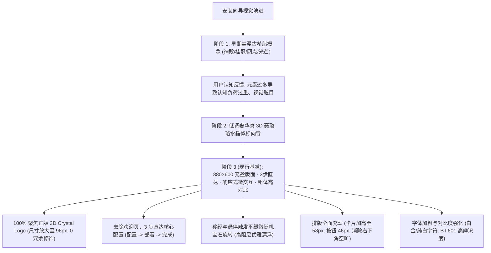

# IDE1.0 3D 赛璐珞美漫水晶徽标安装向导基本设计书

**文档编号**: BD-INSTALLER-3D-CRYSTAL-2026-V2.1  
**制定组织**: IDE1.0 交互体验与视觉工程委员会  
**基准版本**: v2.1 (演进定稿)  
**状态**: 承认済 (Baseline Locked)  
**关联设计**:
- [BD-001_基本设计书.md](./BD-001_基本设计书.md)
- [DD-004_3D-Crystal-Logo-Shader-Pipeline.md](../02_详细设计/DD-004_3D-Greek-Temple-Shader-Pipeline.md)

---

## 1. 设计愿景与美学演进 (Aesthetic Vision & Evolution)

传统的 Windows 安装程序界面（如 Windows Installer 默认灰框、原生 Back/Next/Cancel 按钮）陈旧呆板，无法传递现代高性能纯 Rust 开发工具的工业魅力。
IDE1.0 彻底抛弃传统原生向导设计，经历以下演化与收敛：

---

## 2. 空间结构与构件规格 (Spatial Architecture & Specifications)

| 构件层级 | 构件名称 | 艺术设计表现 | 材质与着色技术 |
| :--- | :--- | :--- | :--- |
| **3D 展台核心** | **正版 IDE1.0 水晶钻石 Logo** | 悬浮、缓慢自转的八面菱形双棱锥切割晶体（96.0px 比例），核心立体悬浮发光 `< I >` 代码符号。 | 3 阶赛璐珞光照 (`CrystalDiamondLight / Mid / Dark` + `CrystalCoreGlyph`) + 1.8px 纯黑外墨线。 |
| **展台微交互** | **响应式随机缓慢旋转** | 鼠标在窗口或按钮上移动时触发微随机冲量，高阻尼平滑插值过渡，静止时保持极缓自转。 | 空间坐标+时间确定性哈希驱动，消除繁琐 HUD 按钮与手动拖拽认知负担。 |
| **展台地面空间** | **地面呼吸接触阴影 (Contact Shadow)** | 晶钻下方地面的柔和暗色多边形投影，伴随晶石浮动自适应微缩放。 | 24 点凸多边形柔和暗化 (`Color32::from_black_alpha(110)`)，空间接地感极强。 |
| **展台氛围背景** | **暗场天青微光辉光 (Luxury Glow)** | 晶体背后的柔和双层低透明度同心微光，降低背景视觉死板，凸显主体。 | 极低 Alpha 漫反射天青蓝补光 (`#0284c70e` / `#0ea5e916`)，0 眩目感。 |
| **外框与标题栏** | **精工黑曜钛金栏与宝蓝分割线** | 880×600 无边框视口，自绘行动条标题栏、拖拽把手、最小化与关闭按钮。 | `#141924` 黑曜钛金底色 + 1.8px `#0284c7` 皇家宝蓝下边框。 |
| **步骤与交互面板** | **多步配置向导面板 (Wizard Content)** | 3 步状态机（配置 -> 部署 -> 完成），卡片与按钮均整排布，消除右下角空旷。 | 沉稳黑曜底面板 + 58px 交互复选卡片 + 46px 底部主操作条。 |

---

## 3. 色彩心理学与低认知负荷设计规范

1. **排除视觉噪音与认知负荷控制**：
   - 彻底移除了古希腊神殿立柱台座、月桂冠金饰、20 束旋转光芒、48 颗星尘粒子涡旋以及 "POW!" 贴纸；
   - 展台仅留唯一的视觉核心：**正版 3D Crystal Logo**，用户注意力得以 100% 聚焦于品牌识别与安装决策；
   - 移除 `360° 拖拽观察 · 双击复位` 胶囊，改为无感的响应式轻柔自转。
2. **色彩心理学应用 (Color Psychology)**：
   - **黑曜钛金暗色底盘 (`#0e121a` ~ `#141924`)**：降低屏幕发射光线通量，提供低眩光、高舒适度的暗室体验，减轻眼部睫状肌疲劳；
   - **皇家宝蓝（Royal Sapphire `#0284c7`）**：在色彩心理学中象征理智、科技、高可靠性与沉着自信，用作主行动条强调色与“立即安装”按钮基色；
   - **翡翠绿（Emerald Green `#10b981`）**：象征平稳、安全与成功，专用于安装完成阶段的成功指示与最终启动按钮；
   - **紫罗兰与天青辅助分级**：快捷方式与环境变量分别采用 `#a855f7` 与 `#0ea5e9` 柔和色系，信息分层清晰自明。
3. **版面充盈与排版平衡**：
   - 视口整体拓宽至 880×600，右侧面板宽度扩至 ~510px；
   - 目录输入框与浏览按钮加高至 38px，复选卡片统一增至 58px，行间距均匀；
   - 底部行动栏（立即安装 46px + 取消 46px）横向铺满，杜绝右下角大面积留白。

---

## 4. 便笺与主界面首次启动不变量规范

1. **首启静默原则**：
   - 便笺独立视口首次启动默认处于关闭状态（`open: false`），由用户按需主动唤起；
   - 左侧导航栏首次启动默认处于折叠关闭状态（`side_open: false`），给予编辑区最大开阔视野；
   - 用户的打开/折叠状态一旦变更，立即进行磁盘原子持久化，下次启动精准还原。
2. **便笺格式化目标即选区引擎**：
   - 删除线（`~~`）、粗体（`**`）、斜体（`*`）、下划线（`<u>`）在编辑模式下以高亮选中文本为第一目标，包裹或就地 Toggle Off；
   - Markdown 预览模式下以当前聚焦行或块为目标，实时反映并更新预览，严禁盲目在文本尾部追加模板字符。
