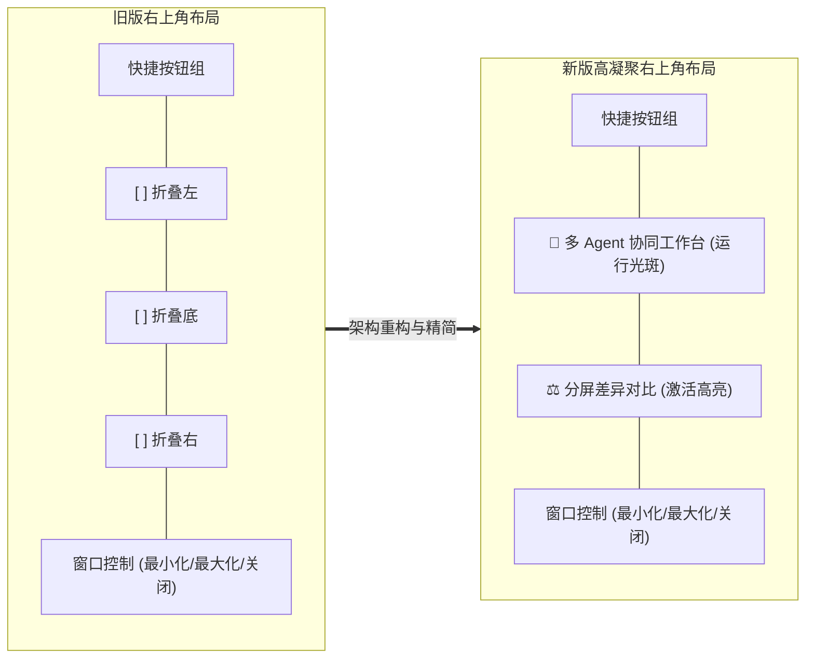
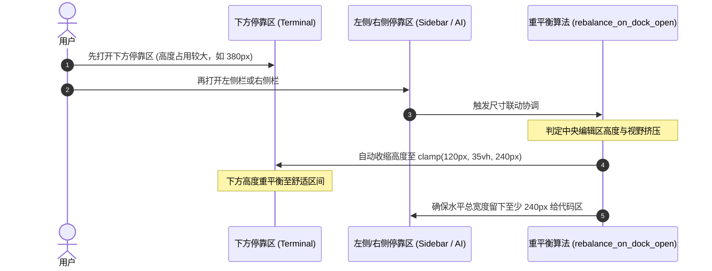

# IDE1.0 标题栏分屏差异对比与停靠面板自适应联动基本设计书

**文档编号**: BD-TITLEBAR-DIFF-DOCK-2026-V1.0  
**制定组织**: IDE1.0 客户端架构委员会  
**基准版本**: v1.0  
**状态**: 承认済 (Baseline Locked)  
**关联设计**:
- [BD-001_基本设计书.md](./BD-001_基本设计书.md)
- [DD-005_Titlebar-WinMergeDiff-and-Panel-Rebalance.md](../02_详细设计/DD-005_Titlebar-WinMergeDiff-and-Panel-Rebalance.md)

---

## 1. 背景与设计重构动机

旧版标题栏右上角曾放置了 3 个空心方块面板折叠开关（`[ ] [ ] [ ]`，分别用于左侧栏、底栏、右侧栏）。实际使用中反馈：
1. 占用宝贵的标题栏空间，与菜单栏右侧快捷图标产生拥挤；
2. 侧栏与终端底部已有细条点击折叠区（`Strip`），标题栏上的 3 个开关属于重复入口；
3. 用户在文本与代码编辑过程中，高频需要双文档即时分屏差异对比与多 Agent 协同入口，缺乏醒目的直达通道。

本次设计彻底移除 3 个冗余折叠方块，替换为 **分屏差异对比快捷入口** 与 **多 Agent 协同工作台快捷入口**，并将折叠尺寸自动协调机制全面对齐 Tauri 原版算法。

---

## 2. 分屏差异对比快捷入口设计

1. **自绘矢量双页对比图标 (`paint_diff_icon`)**：
   - 绘制左右两张轻微错位、带有水平文本代码刻线的小白页；
   - 当对比模式处于激活状态时，中心点绘制高亮天青蓝（`#00c8ff`）对比连接节点，背景衬以半透明浅蓝光晕（`Color32::from_rgba_unmultiplied(0, 180, 255, 40)`）。
2. **快捷动作菜单 (`DiffAction`)**：
   - **与磁盘文件对比…**：弹出原生文件选择对话框，选定外部文件即刻与当前 Tab 建立双栏 Diff；
   - **与已有 Tab 对比…**：下拉列出当前打开的其他文档，一键建立比对；
   - **差异跳转**：提供 `下一个差异 (Alt+Down)` 与 `上一个差异 (Alt+Up)` 快速定位；
   - **关闭对比**：一键退出对比模式并清理比对标记。

---

## 3. 面板折叠自适应尺寸联动算法 (`rebalance_on_dock_open`)

为了保障中央代码编辑区的黄金可视视野，当用户连续展开多个停靠区时，系统执行自动几何重平衡：

- **下开先、侧开后**：若下方折叠已展开，打开侧栏时自动收缩下方高度至 `clamp(120px, 35vh, 240px)`，绝不遮挡主编辑视野。
- **两翼夹击保护**：当左侧栏与右侧栏同时展开时，约束 `side_w + right_w <= viewport_w - 240px`，先开者主动给后开者让位，保证中央编辑区宽度永不低于 `240px`。
