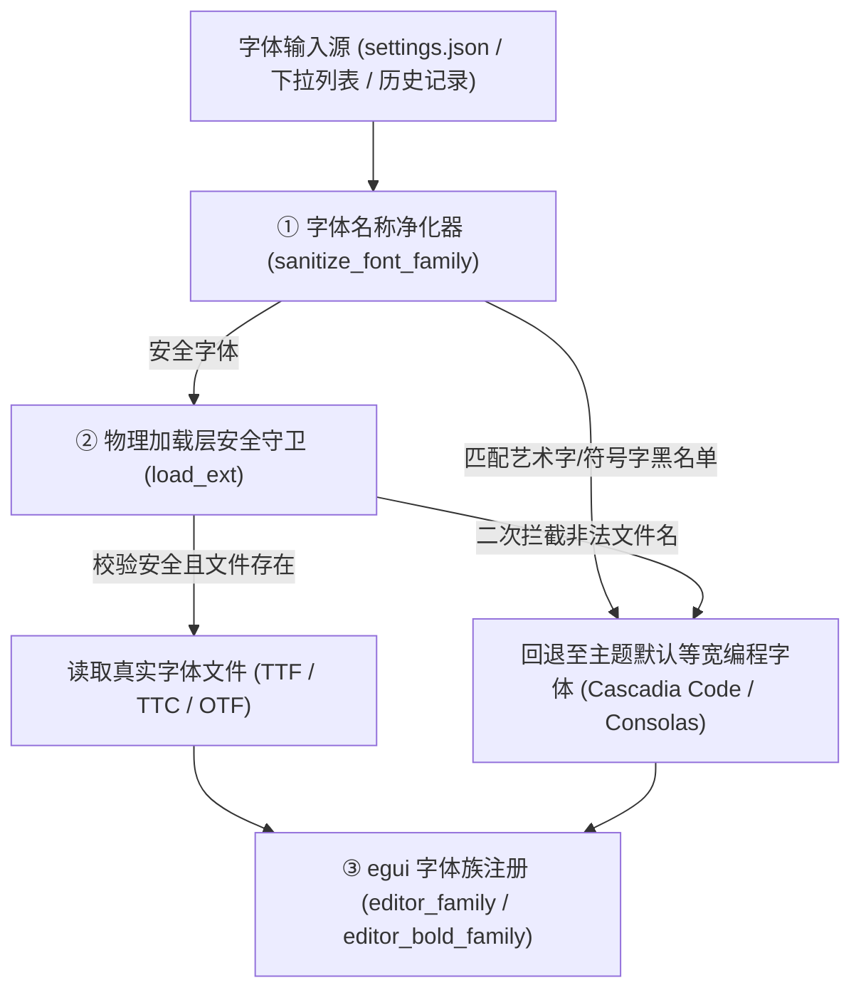

# IDE1.0 代码字体防畸变、UI中立化、系统托盘常驻与 AI 额度诊断基本设计书

**文档编号**: BD-FONT-TRAY-AI-2026-V1.0  
**制定组织**: IDE1.0 基础设施与客户端体验委员会  
**基准版本**: v1.0  
**状态**: 承认済 (Baseline Locked)  
**关联设计**:
- [BD-001_基本设计书.md](./BD-001_基本设计书.md)
- [DD-006_Font-Sanitizer-Tray-and-AI-Diagnostics.md](../02_详细设计/DD-006_Font-Sanitizer-Tray-and-AI-Diagnostics.md)

---

## 1. 代码字体防畸变拦截与高可读性保障体系

### 1.1 痛点与风险
在 Windows 等操作系统中，系统字体目录下预装了大量**手写花体、哥特书法体、戏剧标题体以及特殊符号字体**（如 `OLDENGL.TTF`、`BODONI.TTF`、`WINGDINGS.TTF`、`SYMBOL.TTF`）。
若系统不加防范直接加载此类字体，会导致编辑器数字、英文字母及符号严重畸变，完全无法阅读，造成严重认知障碍。

### 1.2 架构防护矩阵

1. **多重特征黑名单库 (`is_illegible_display_font`)**：
   - 过滤词库收录：`OLDENG`、`FRAKTUR`、`BLACKLETTER`、`BODONI`、`PLAYBILL`、`CHILLER`、`CURLZ`、`PAPYRUS`、`SHOWG`、`CASTELAR`、`EDWARDIAN`、`KUNSTLER`、`WINGDINGS`、`WEBDINGS`、`SYMBOL`、`MARLETT` 等 40+ 种非代码阅读字体。
2. **物理文件加载层安全底线**：
   - 在 [`load_ext`](file:///e:/IDE1.0/ide-fast/src/fonts.rs) 中增加前置判定 `!is_illegible_display_font(&safe_editor)`，无论上层如何传入非法字型名，物理 I/O 层直接拒读并回退到系统等宽兜底字体。
3. **彻底去 Sakura 化与通用品牌中立**：
   - 清理界面中所有遗留的 `Sakura` 品牌字样，确保面向通用现代极速 IDE 定位。

---

## 2. 增强型系统托盘常驻与右键上下文设计

### 2.1 托盘生命周期与常驻机制
- **常驻后台模式 (`tray_resident = true`)**：用户点击窗口关闭按钮（`✕`）时不销毁进程，而是向操作系统发送 `Visible(false)` 隐藏主窗口并保留托盘驻留，实现秒级热唤醒。
- **用户自决权**：托盘右键菜单提供显式的“常驻后台 (勾选)”以及“退出托盘常驻”选项，允许用户随时恢复常规单窗口生命周期。

### 2.2 丰富上下文右键菜单规约
| 菜单项 | 快捷键提示 | 行为语义 |
| :--- | :--- | :--- |
| **显示 / 隐藏 IDE** | — | 若窗口最小化或隐藏则立即恢复聚焦；若已处于前台激活状态则隐藏至托盘。 |
| **新建空白文档** | `Ctrl+N` | 唤醒窗口并在新 Tab 创建未命名文档。 |
| **打开文件…** | `Ctrl+O` | 唤醒窗口并弹出原生文件选择对话框。 |
| *(分隔线)* | — | — |
| **🤖 多 Agent 协同工作台…** | — | 唤醒窗口并直接展开 Multi-Agent 协同工作台。 |
| **差异对比…** | — | 唤醒窗口并弹出差异对比文件选择器。 |
| *(分隔线)* | — | — |
| **窗口置顶 (Always on Top)** | — | 复选菜单项，动态切换主窗口的 `WindowLevel`。 |
| **常驻后台 (关闭窗口时隐藏到托盘)** | — | 复选菜单项，动态切换是否允许后台驻留。 |
| **退出托盘常驻** | — | 立即销毁系统托盘图标，使主窗口恢复普通窗口退出行为。 |
| *(分隔线)* | — | — |
| **退出 IDE** | — | 设置 `force_exit = true` 并完全终止应用程序生命周期。 |

---

## 3. AI 额度耗尽深度诊断与 HTTP 0 根治规范

### 3.1 错误场景与成因剖析
在接入各厂商 AI 服务端（OpenAI、Anthropic、DeepSeek、OneAPI 等）时，用户经常遇到红色干瘪的 `HTTP 0`，其本质原因为：
- **场景 A（额度耗尽/欠费）**：服务端返回 HTTP 429 或 402，响应体 JSON 带有 `insufficient_quota` 或 `billing_not_active`，此前流式解析器因非 2xx 直接忽略响应体。
- **场景 B（连接建立失败）**：目标 URL 域名未解析、本地代理端口拒绝、或 SSL 证书不匹配，导致底层 curl 退出（HTTP 状态码为 0），错误原因沉睡在 stderr 中。

### 3.2 诊断与转换规范
1. **JSON 错误体穿透解析 (`extract_error_detail`)**：优先尝试提取 `error.message`、`error.code`、`error.type` 及 `detail` 字段。
2. **额度欠费语义转换**：命中 `insufficient_quota` / `quota_exceeded` / `out of credits` / `欠费` 时，输出规范提示：
   > `【API 额度耗尽 / 账户欠费】服务商返回: <具体明细>。请前往 API 提供商后台检查账单与额度充值，或在设置中更换有效的 API Key。`
3. **状态码 0 的 curl 诊断转化**：
   - `Could not resolve host` $\to$ `域名无法解析，请检查 Base URL 是否正确或网络 DNS`
   - `Connection refused` $\to$ `服务连接被拒绝，目标地址可能未启动或端口不通`
   - `Timed out` $\to$ `网络连接超时，请检查网络通畅度或系统代理`
   - `SSL/certificate` $\to$ `SSL 证书握手失败，请检查 HTTPS 证书或代理配置`
