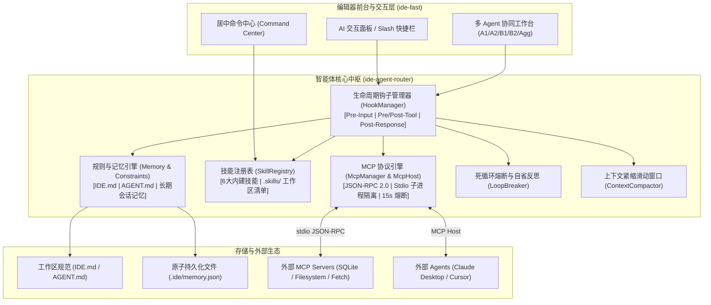

# BD-006: AI Agent 完备生态体系设计说明书 (Memory, Constraints, Hooks, Skills & MCP)

## 1. 体系背景与设计目标

随着 IDE 1.0 的演进，AI 研发助手已从单轮问答工具转变为参与端到端研发的自治协作体。为满足现代高阶智能体系统要求，必须在保持 **60~120fps 界面零卡顿、启动零开销、进程级隔离** 的严苛性能约束下，构建完整的智能体基建设施：
1. **记忆与约束体系**：标准化支持工作区级 `IDE.md`、`AGENT.md`（及 `.cursorrules`、`CLAUDE.md`）的项目规范约束注入与长短期记忆持久化；
2. **生命周期拦截器 (Hooks)**：覆盖用户输入、模型回复、工具调用前后及代码提交的全链路审查与权限控制；
3. **技能引擎 (Skill System)**：结构化、可复用、带 Slash 命令（`/review`, `/test` 等）的专业能力抽象；
4. **模型上下文协议 (MCP)**：同时具备外部 MCP Server 连接与 IDE 原生 MCP 能力开放的双向适配；
5. **常规必备安全网**：上下文智能压缩、死循环自省熔断、产物提取等生产级保障。

---

## 2. 总体架构拓扑 (Mermaid Architecture)

---

## 3. 工作分解结构 (WBS - Work Breakdown Structure)

| 阶段 | 编号 | 模块 / 任务项 | 交付成果与技术规范 | 优先级 |
|---|---|---|---|---|
| **WBS-01** | 01.1 | **规则与约束解析器** | 递归解析 `IDE.md`, `AGENT.md`, `.cursorrules`, `CLAUDE.md`，提取全局指令、安全边界与技术栈约束 | P0 (核心) |
| | 01.2 | **会话与长期记忆引擎** | 维护当前会话活跃工作区状态，支持关键实体提取与 `.ide/memory.json` 原子化落盘与回灌 | P0 (核心) |
| **WBS-02** | 02.1 | **生命周期 Hooks 管道** | `pre_input`, `post_input`, `pre_tool_call`, `post_tool_call`, `post_response` 五级链式拦截 | P0 (核心) |
| | 02.2 | **权限与敏感路径熔断器** | 拦截针对系统根目录、私钥及敏感配置的恶意读取与破坏性覆盖 | P0 (核心) |
| **WBS-03** | 03.1 | **技能注册与 Slash 触发** | 内建 `/review`, `/refactor`, `/test`, `/nema`, `/commit`, `/explain` 等高频技能，支持动态扩展 | P0 (核心) |
| | 03.2 | **工作区动态技能加载** | 惰性加载 `.skills/<id>/SKILL.md`，零主线程 I/O 开销 | P1 (增强) |
| **WBS-04** | 04.1 | **MCP Client 客户端总线** | JSON-RPC 2.0 异步子进程生命周期管理，工具注册为 `mcp_{server}_{tool}` | P0 (核心) |
| | 04.2 | **MCP Server 原生开放端** | 对外暴露 `ide_read_file`, `ide_apply_patch`, `ide_nema_convert` 等高能工具 | P1 (增强) |
| **WBS-05** | 05.1 | **死循环自省反思熔断** | 工具连续重复调用检测 (3次同参阈值) 与自动上下文提示修复 | P0 (核心) |
| | 05.2 | **上下文动态压缩与裁剪** | 超过 token 上限时执行滑动窗口与非破坏性摘要裁剪 (Auto-Compact) | P0 (核心) |
| **WBS-06** | 06.1 | **详细设计文档入册** | 编写 `DD-007_Agent-Memory-Constraint-Hooks-and-MCP-Specification.md` | P0 (文档) |
| | 06.2 | **全量测试与验证** | 编写单元测试套件，验证零性能衰减、内存安全与异常隔离 | P0 (质保) |

---

## 4. 核心系统职责与边界

### 4.1 规则与记忆体系 (Memory & Constraints)
1. **工作区规则发现（Hierarchical Rule Discovery）**：
   - 优先级：工作区根目录 `AGENT.md` > `IDE.md` > `.ide/rules.md` > `.cursorrules` > `CLAUDE.md`。
   - 解析出的规则以 `[Workspace Invariants & Constraints]` 格式显式注入至模型第一轮 System Prompt 中。
2. **长期记忆（Long-term Memory）**：
   - 提取会话中的关键架构共识、用户偏好、重要技术选型；
   - 存入 `<workspace>/.ide/memory.json`，在后续新会话或重置会话中选择性召回；
   - 读写全程异步后台线程完成，零主线程阻塞。

### 4.2 拦截器体系 (Lifecycle Hooks)
1. **`pre_input`**：注入工作区规则约束、召回关联记忆、解析 Slash Command 对应 Skill；
2. **`pre_tool_call`**：校验工具参数合法性、路径逃逸检测、危险命令防护（只读/写权限门控）；
3. **`post_tool_call`**：工具输出结果尺寸限制截断（`MAX_TOOL_RESULT = 20_000`）、敏感信息脱敏；
4. **`post_response`**：检测连续重复模式、代码块完整性检查、补丁提案格式提取。

### 4.3 技能体系 (Skill Engine)
- 支持以 `/` 开头的快捷 Slash 触发器，即刻切换专家思考模式与对应提示词模板；
- 支持与多 Agent 协同工作台槽位（Router / Group A / Group B / Aggregator / Verifier）绑定。

### 4.4 MCP 体系 (Model Context Protocol)
- 客户端支持连接任意标准 MCP 服务器；
- 管道 I/O 采用独立 Worker 线程，设置 15 秒硬超时与自动崩溃重连；
- 服务端支持将 IDE 内部编辑器上下文、NEMA 拓扑转换能力对外标准化输出。

---

## 5. 性能与不变量承诺

- **不变原则**：
  1. **零冷启等待**：任何规则扫描、MCP 子进程孵化与持久化均采取按需惰性触发，IDE 启动时间不受任何影响；
  2. **零帧渲染阻滞**：egui 渲染循环内杜绝任何同步磁盘读写与阻塞等待；
  3. **沙箱与异常安全**：遵循 `#![forbid(unsafe_code)]`，子进程挂起、管道破裂或外部服务崩溃均被安全捕获并显式降级，绝不导致主程序崩溃。
