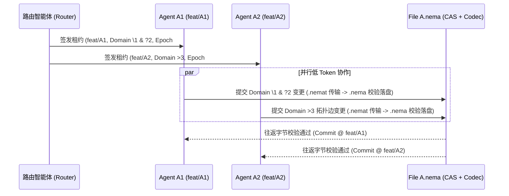

# IDE1.0 多智能体协同开发平台详细设计书（Router · `.nema` 协同 · Aggregator 转换 · Git · Verify 闭环）

**文档编号**: DD-AGENT-NEMA-2026-V3.0  
**制定组织**: IDE1.0 内核与多智能体架构委员会  
**基准版本**: v3.0  
**状态**: 承认済 (Baseline Locked)  
**上游设计**: [BD-002_Multi-Agent-NEMA-Collab-Platform.md](../01_基本设计/BD-002_Multi-Agent-NEMA-Collab-Platform.md)  
**关联模块**: `crates/nema-codec`, `crates/ide-agent-router`, `crates/editcore`, `ide-fast`, `crates/ide-shell-web`, `crates/ide-shell-desktop`

---

## 1. 阶段 ①：路由智能体 (`Router Agent`) 详细设计

### 1.1 任务输入与路由拆解模型 (`TaskDecompositionPlan`)

路由智能体接收高层研发请求（功能开发 / 缺陷修复 / 模块优化 / 重构升级），输出确定性的文件分配、协作编组与 Git 分支拓扑计划：

```rust
#[derive(Debug, Clone, Copy, PartialEq, Eq, Serialize, Deserialize)]
pub enum TaskInputKind {
    /// 功能开发
    FeatureDevelopment,
    /// 缺陷修复
    DefectRepair,
    /// 模块优化
    ModuleOptimization,
    /// 重构升级
    RefactoringUpgrade,
}

#[derive(Debug, Clone, PartialEq, Eq, Serialize, Deserialize)]
pub enum CollaborationGroupKind {
    /// 协同编辑组 A：多 Agent 在不同分支 (feat/A1, feat/A2) 共同协作同一 .nema 文件
    CoEditingSameFile {
        nema_file: String,         // e.g., "specs/File_A.nema"
        target_rust_file: String,  // e.g., "src/a.rs"
        assignments: Vec<CoEditBranchAssignment>,
    },
    /// 独立编辑组 B：各 Agent 在各自独立分支 (feat/B1, feat/B2) 独占编辑独立 .nema 文件
    IndependentFiles {
        assignments: Vec<IndependentBranchAssignment>,
    },
}

#[derive(Debug, Clone, PartialEq, Eq, Serialize, Deserialize)]
pub struct CoEditBranchAssignment {
    pub agent_id: String,          // e.g., "Agent-A1", "Agent-A2"
    pub branch_name: String,       // e.g., "feat/A1", "feat/A2"
    pub allowed_domains: Vec<String>, // 允许修改的 NEMA 域 ID，如 ["1", "2"]
    pub record_key_prefix: Option<String>, // 同域内允许修改的主键前缀或 EdgeId 范围
    pub fencing_token: u64,
}

#[derive(Debug, Clone, PartialEq, Eq, Serialize, Deserialize)]
pub struct IndependentBranchAssignment {
    pub agent_id: String,          // e.g., "Agent-B1", "Agent-B2"
    pub branch_name: String,       // e.g., "feat/B1", "feat/B2"
    pub nema_file: String,         // e.g., "specs/File_B.nema", "specs/File_C.nema"
    pub target_rust_file: String,  // e.g., "src/b.rs", "src/c.rs"
    pub fencing_token: u64,
}
```

### 1.2 协作策略判定决策树 (`Collaboration Strategy Decision`)

1. **计算任务写集交集**：
   - 若子任务 $T_i, T_j$ 映射至同一目标模块（如 `File A.nema` $\to$ `A.rs`）：
     - 若两者操作不同的 NEMA 域（例如 `Agent A1` 编辑 `\t?1` 5W1H 规约与 `\t\2` 数据结构表，`Agent A2` 编辑 `\t>3` 状态流转拓扑图），或操作同一域内主键不相交的记录行 $\implies$ 编入 **协同编辑组 A (`CoEditingSameFile`)**，分别创建分支 `feat/A1` 与 `feat/A2` 并行作业。
     - 若 $T_i$ 的输出类型契约是 $T_j$ 的前置输入 $\implies$ 在依赖 DAG 中建立有向边 $T_i \to T_j$。
   - 若子任务操作彼此独立的模块文件（如 `File B.nema` $\to$ `B.rs`、`File C.nema` $\to$ `C.rs`） $\implies$ 编入 **独立编辑组 B (`IndependentFiles`)**，分配 `feat/B1` 与 `feat/B2` 全速并行。

---

## 2. 阶段 ②：`.nema` 原生并行协作详细设计

### 2.1 `.nema` 多智能体协作规约结构

每个 `.nema` 协作单元由三类标准语义域构成，兼顾人类可读可视化与超低 Token 传输：

1. **Table 域 (`\t\<id> [rev]`) — 类型、结构体与状态转移表**：
   - 首行以精确 `\\ ` 前缀声明显式列名（如 `\\ StructName FieldName RustType Visibility Constraint`）；未声明时默认 `column1...`。
   - 多行空格缩进续接意群 `Vec<Vec<SemanticChunk>>`（缩进空格数 $K \implies$ 续接上一记录的第 $K-1$ 列）。
2. **5W1H 域 (`\t?<id> [rev]`) — 函数契约与不变量规约**：
   - 固定六列：`What (函数签名/职责)`、`Why (设计意图/业务目标)`、`How (核心算法/步骤)`、`Who (调用方/权限角色)`、`When (触发条件/生命周期/超时)`、`Where (所属模块/错误边界)`。
3. **Graph 域 (`\t><id> [rev]`) — 模块依赖、调用图与状态机拓扑**：
   - 节点声明：`NodeId RoleName Description...`
   - 边声明（保有独立 Edge ID）：
     - 正向有向边：`A>E1>B Calls WithRetryPolicy`（$A \to B$，边 ID 为 `E1`）
     - 反向有向边：`B<E2<C Returns AckPayload`（$C \to B$，边 ID 为 `E2`）
     - 无向关联边：`A=E3=B SharesInvariants`（$A \leftrightarrow B$，边 ID 为 `E3`）

### 2.2 同文件多分支无冲突锚点机制 (`Co-Editing Group A`)



---

## 3. 阶段 ③：统筹智能体 (`Aggregator Agent`) 与 `.nema → Rust` 转换详细设计

### 3.1 步骤 ① & ②：多分支 `.nema` 三方语义合并算法 (`NemaSemanticMerger`)

当统筹智能体汇总 `feat/A1`、`feat/A2`（共同修改 `File A.nema`）以及 `feat/B1`（`File B.nema`）、`feat/B2`（`File C.nema`）时，对共同编辑文件执行以下四步确定性合并：

```rust
pub struct NemaMergeOutcome {
    pub merged_document: NemaDocument,
    pub rendered_nema_source: String,
    pub remapped_dictionary: Vec<String>,
    pub conflicts: Vec<NemaSemanticConflict>,
}

#[derive(Debug, Clone, PartialEq, Eq, Serialize, Deserialize)]
pub struct NemaSemanticConflict {
    pub file_path: String,
    pub domain_id: String,
    pub record_key: String,
    pub column_index: usize,
    pub branch_lhs: (String, String), // (feat/A1, value)
    pub branch_rhs: (String, String), // (feat/A2, value)
    pub resolution: ConflictResolutionStrategy,
}
```

1. **Step 1 — 共享词典去重与重编号 (`Dictionary Unification`)**：
   - 将 Base、`feat/A1`、`feat/A2` 的词典合并为有序无重复词集 $D_{\text{merged}}$，并将两分支记录中的 `AtomChunk::DictionaryRef { index, value }` 按 `value` 重新绑定至新索引，彻底消除词典下标冲突。
2. **Step 2 — 域级路由合并 (`Domain-Level Merge`)**：
   - 按 `domain.id` 对齐 Base、`feat/A1`、`feat/A2`。
   - 若某域仅在 `feat/A1` 中新增或修改，直接采纳 `feat/A1` 版本并递增 `domain.revision`；反之采纳 `feat/A2`。
3. **Step 3 — 域内记录/拓扑边合并 (`Record & Edge-Level Merge`)**：
   - **Table / 5W1H 域**：以每条 `NemaRecord` 的第 0 列（主键标识符）作为锚点。不同主键的增删改自动无损合并；同一主键的不同列修改自动按列合并。
   - **Graph 域**：节点按 `NodeId` 合并，边按独立 `EdgeId` 合并，并自动执行连通性校验（若某分支新增边引用了未声明节点，抛出 `NEMA-E003` 并由统筹智能体补齐节点或打回）。
4. **Step 4 — 细粒度单元格冲突裁决 (`Cell Conflict Resolution`)**：
   - 仅当 `feat/A1` 与 `feat/A2` 同时将同一 `(domain_id, record_key, col_idx)` 从 $V_0$ 修改为不相等的 $V_1 \neq V_2$ 时，由 `Aggregator` 依据 `Router` 签发的 `GuidanceZone` 权责表自动裁决，或生成带双方上下文的合并补丁。

### 3.2 步骤 ③：`.nema → Rust` 结构化代码生成 (`NemaToRustLowering`)

合并后的 `.nema` 文档通过结构化降维器（Lowering Engine）生成 `A.rs`、`B.rs`、`C.rs`：

| `.nema` 语义结构 | 生成的 Rust AST / 源码结构 (`*.rs`) | 双向 SourceMap 锚点 |
|:---|:---|:---|
| **模块顶层约束** | `#![forbid(unsafe_code)]` + 模块级 `//!` 文档注释 | `file_root` |
| **Graph 域 (`\t>N`)**<br>`A>E1>B` / `B<E2<C` | `use crate::...;` 模块导入、Trait 关联类型约束、状态机状态转移 `enum` 与通道调用拓扑 | `GraphEdge(domain_id, edge_id)` $\leftrightarrow$ `qualified_symbol_path` |
| **Table 域 (`\t\N`)**<br>`\\ Type Field RustType ...` | `#[derive(Debug, Clone, PartialEq, Eq, Serialize, Deserialize)]`<br>`pub struct / pub enum` 定義及常量映射表 | `TableRecord(domain_id, row_key)` $\leftrightarrow$ `struct_item / enum_item` |
| **5W1H 域 (`\t?N`)**<br>`What / Why / How / Who / When / Where` | `/// [Why] ...`<br>`/// [When/Where] ...`<br>`pub fn <what_sig>(...) -> Result<..., Error>` 函数实现与前置/后置不变量断言 | `FiveWOneHRecord(domain_id, fn_name)` $\leftrightarrow$ `function_item` |

```rust
#[derive(Debug, Clone, PartialEq, Eq, Serialize, Deserialize)]
pub struct NemaRustSourceMapEntry {
    pub nema_file: String,
    pub domain_id: String,
    pub domain_mode: DomainMode,
    pub record_key: String,
    pub nema_span: TextSpan,
    pub source_branch: String,       // e.g., "feat/A1"
    pub rust_file: String,           // e.g., "src/a.rs"
    pub rust_symbol_path: String,    // e.g., "crate::a::Gateway::forward"
    pub rust_line_range: (usize, usize),
}
```

---

## 4. 阶段 ④：文件级 Git 版本管理与验证智能体 (`Verify Agent`) 详细设计

### 4.1 文件级 Git 分支编排 (`GitBranchOrchestrator`)

系统采用多分支并行、文件级收敛的 Git 拓扑策略：

```
main (稳定受保护主干)
 ├── feat/A1  (Agent A1: 协同编辑 File A.nema [域 \1, ?2])
 ├── feat/A2  (Agent A2: 协同编辑 File A.nema [域 >3])
 ├── feat/B1  (Agent B1: 独立编辑 File B.nema)
 └── feat/B2  (Agent B2: 独立编辑 File C.nema)
       │
       ▼ (Aggregator 汇总 A1+A2+B1+B2 -> 语义合并 -> 生成 A.rs, B.rs, C.rs)
   agg/epoch-N (统筹候选分支: 发起 PR 合并请求 & Diff 审查)
       │
       ▼ (Verify Agent 四道门禁全绿 + 签发 AcceptanceCertificate)
main (原子 Merge 合入稳定主干 -> 产出可发布产物)
```

四大 Git 标准操作契约：
1. **`Commit 提交`**：每个分支提交自动附带结构化 Git Trailer：
   - `X-IDE-Agent-Id: Agent-A1`
   - `X-IDE-Branch-Group: CoEditGroup-A`
   - `X-IDE-Nema-Hash: sha256:...`
   - `X-IDE-Fencing-Token: 42`
2. **`Diff 差异`**：同时提供 `.nema` 语义级差异（表格行列增删、5W1H 轴变更、Graph 节点/边拓扑对比）与生成的 `A.rs / B.rs / C.rs` Rust AST 差异。
3. **`PR 合并请求`**：由 `Aggregator` 自动组装多分支合并报告、冲突消解记录、`NemaRustSourceMap` 与 Token 节省率指标。
4. **`Merge 合并`**：仅当 `Verify Agent` 验证通过并附上 `AcceptanceCertificate` 签名时，允许合入 `main`。

### 4.2 验证智能体 (`Verify Agent`) 四级流水线与反馈闭环

```rust
#[derive(Debug, Clone, PartialEq, Eq, Serialize, Deserialize)]
pub struct VerifyPipelineReport {
    pub epoch: u64,
    pub candidate_commit: String,
    pub build_passed: bool,          // 1. 构建验证 (cargo check / cargo build)
    pub tests_passed: bool,          // 2. 单元/集成测试 (cargo test)
    pub quality_passed: bool,        // 3. 质量检查 (clippy / complexity / formatting)
    pub spec_compliance_passed: bool,// 4. 规范校验 (forbid(unsafe_code) / NEMA roundtrip / SecretRef)
    pub certificate: Option<AcceptanceCertificate>,
    pub feedback_tickets: Vec<IterationFeedbackTicket>,
}

#[derive(Debug, Clone, PartialEq, Eq, Serialize, Deserialize)]
pub struct IterationFeedbackTicket {
    pub failed_gate: String,         // "Build" | "UnitTest" | "Quality" | "Spec"
    pub rust_file: String,           // e.g., "src/a.rs"
    pub rust_line: usize,
    pub mapped_nema_file: String,    // 经 NemaRustSourceMap 反查: "specs/File_A.nema"
    pub mapped_domain_id: String,    // e.g., "3"
    pub mapped_record_key: String,   // e.g., "B<Z<A"
    pub responsible_branch: String,  // e.g., "feat/A2"
    pub responsible_agent: String,   // e.g., "Agent-A2"
    pub diagnostic_summary: String,
    pub suggested_task_kind: TaskInputKind, // 回流至阶段 ① Router 的任务类型
}
```

### 4.3 🔄 反馈与迭代（持续优化闭环）状态流转

1. **正向收敛路径（Pass Path）**：
   - `VerifyPipelineReport` 四项门禁全为 `true` $\implies$ 签发 `AcceptanceCertificate` $\implies$ Git `Merge` 合入 `main` $\implies$ 输出 **Rust 代码 (`A.rs`, `B.rs`, `C.rs`) / 构建包 / 可发布产物**。
2. **逆向自愈路径（Feedback Loop Path）**：
   - 若任一门禁失败（例如 `B.rs` 调用 `A.rs` 某方法时签名不匹配或单元测试断言失败）：
     1. `Verify Agent` 解析编译器/测试 JSON 诊断，提取 `(rust_file, rust_line)`；
     2. 查询 `NemaRustSourceMap` 反查出对应的 `(nema_file, domain_id, record_key, responsible_branch, responsible_agent)`；
     3. 生成 `IterationFeedbackTicket` 并自动注入阶段 ① **任务输入 (`DefectRepair` / `ModuleOptimization`)**；
     4. `Router Agent` 仅唤醒受影响的责任分支（如 `feat/A2`）执行增量 `.nema` 修正，无需重跑已通过且无依赖变更的分支，形成低成本、确定性的持续优化闭环。
