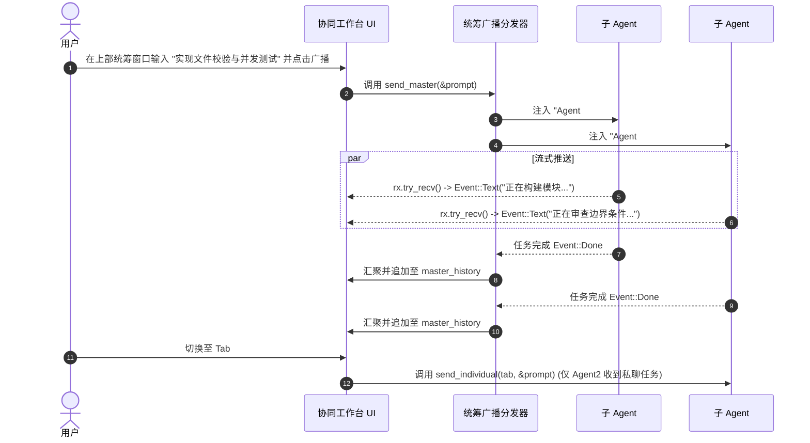

# IDE1.0 多 Agent 协同工作台详细设计书

**文档编号**: DD-COLLAB-WORKSPACE-2026-V1.0  
**制定组织**: IDE1.0 内核与界面工程组  
**基准版本**: v1.0  
**关联设计**:
- [BD-002_Multi-Agent-NEMA-Collab-Platform.md](../01_基本设计/BD-002_Multi-Agent-NEMA-Collab-Platform.md)
- [command_and_worker_contract.md](./contracts/command_and_worker_contract.md)

---

## 1. 数据结构与状态机设计

```rust
/// 单条协同聊天消息
#[derive(Clone, Debug, PartialEq)]
pub struct CollabMsg {
    pub sender: String,     // 发送者 (用户 / Agent #N / 系统)
    pub text: String,       // 消息正文 (支持流式累积)
    pub is_user: bool,      // 是否由用户发送
    pub is_system: bool,    // 是否为系统提示
    pub is_error: bool,     // 是否为错误警告
}

/// 后台子 Agent 运行上下文
pub struct SubAgentRun {
    pub handle: crate::ai::Handle,                 // curl 请求控制句柄 (支持 cancel)
    pub rx: Receiver<crate::ai::Event>,            // 流式事件接收通道
    pub target_collab: bool,                       // 是否为统筹广播任务
}

/// 子 Agent 实例
pub struct SubAgent {
    pub id: usize,                                 // 唯一序号 (1-based)
    pub name: String,                              // 显示名称 (如 "Agent #1 (编码员)")
    pub role_prompt: String,                       // 专属系统角色设定提示词
    pub private_history: Vec<CollabMsg>,           // 该 Agent 独占的私聊历史
    pub private_input: String,                     // 专属私聊输入框文字
    pub run: Option<SubAgentRun>,                  // 当前运行任务
}

/// 多 Agent 协同工作台全局状态
pub struct CollabState {
    pub open: bool,                                // 工作台展开/隐藏
    pub active_tab: usize,                         // 当前选中的子 Agent 标签页下标
    pub agents: Vec<SubAgent>,                     // 子 Agent 列表 (长度 1..=8)
    pub master_history: Vec<CollabMsg>,            // 统筹广播视窗消息流
    pub master_input: String,                      // 统筹广播输入框文字
}
```

---

## 2. 双命令视窗交互与流式聚合调度



---

## 3. 核心接口与错误保护

1. **`set_agent_count(&mut self, target: usize)`**：
   - 限制范围 `1..=8`。
   - 扩容时按默认角色轮转模板补齐：`编码员`、`审查员`、`测试员`、`架构师`、`安全官`、`文档员`、`性能调优`、`产品总监`。
   - 缩容时安全丢弃超出部分并校准 `self.active_tab = self.active_tab.min(self.agents.len() - 1)`。
2. **`collab_poll(&mut self, ctx: &egui::Context)`**：
   - 每帧无锁非阻塞检查各 Agent 的 `rx.try_recv()`。
   - 捕获 `Event::Text(chunk)` 追加到对应消息流；
   - 捕获 `Event::Done(turn)` 归档，若发生错误或额度耗尽，自动以 `CollabMsg::error` 高亮呈现在消息框中，绝不吞没异常。
