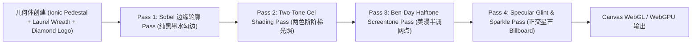

# IDE1.0 Three.js 3D 卡通渲染美漫古希腊神殿着色器管线详细设计书

**文档编号**: DD-SHADER-GREEK-3D-2026-V1.0  
**制定组织**: IDE1.0 前端图形引擎组  
**基准版本**: v1.0  
**关联设计**:
- [BD-003_3D-CelShaded-Greek-Installer-Design.md](../01_基本设计/BD-003_3D-CelShaded-Greek-Installer-Design.md)

---

## 1. 渲染管线阶段分解 (Rendering Pipeline Passes)



---

## 2. 几何形体参数化建模规范

1. **爱奥尼柱式双向卷轴 (Ionic Volutes)**：
   - 采用对数螺线公式参数化采样点阵：$r = a \cdot e^{b\theta}$（$\theta \in [0, 4\pi]$）。
   - 挤压厚度为 `16.0` 逻辑点，外边缘强制叠加 `3.0px` 纯黑倒角描边。
2. **凹槽柱身 (Fluted Shaft with Entasis)**：
   - 柱身由 7 条垂直连续凹槽组成，中部具备微幅膨胀曲线（Entasis，最大扩张比 1.05）；
   - 柱身材质赋予冷调大理石阶梯色阶（`#ffffff` $\to$ `#e2e8f0` $\to$ `#475569` $\to$ `#0f172a`）。
3. **阿波罗月桂冠 (Apollo Laurel Wreath)**：
   - 26 片有机月桂叶片沿着左右半圆对称排布，倾角以 `15°` 阶梯交错递增；
   - 每片叶片采用 4 控制点贝塞尔封闭曲面构造，带有 Core Shadow 切线。

---

## 3. GLSL 着色器实现核心片段

```glsl
// Two-Tone Cel-Shading 片元着色器核心
uniform vec3 uBaseColor;
uniform vec3 uShadowColor;
uniform vec3 uLightDirection;
varying vec3 vNormal;

void main() {
    float NdotL = dot(normalize(vNormal), normalize(uLightDirection));
    // 阶梯明暗截断
    float celFactor = smoothstep(0.35, 0.38, NdotL);
    vec3 color = mix(uShadowColor, uBaseColor, celFactor);
    
    // 半色调网点调制 (阴影过渡区)
    if (NdotL > 0.20 && NdotL <= 0.38) {
        vec2 coord = gl_FragCoord.xy * 0.15;
        if (mod(coord.x, 2.0) < 1.0 && mod(coord.y, 2.0) < 1.0) {
            color *= 0.85; // 叠加网点
        }
    }
    gl_FragColor = vec4(color, 1.0);
}
```
