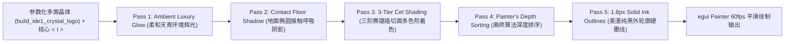

# IDE1.0 3D 赛璐珞水晶徽标渲染管线与几何建模详细设计书

**文档编号**: DD-PIPELINE-3D-CRYSTAL-2026-V2.0  
**制定组织**: IDE1.0 前端图形引擎组  
**基准版本**: v2.0 (演进定稿)  
**关联设计**:
- [BD-003_3D-CelShaded-Greek-Installer-Design.md](../01_基本设计/BD-003_3D-CelShaded-Greek-Installer-Design.md)

---

## 1. 渲染管线阶段分解 (Rendering Pipeline Passes)



---

## 2. 几何形体参数化建模规范 (`build_ide1_crystal_logo`)

1. **八面菱形双棱锥切割冠部与亭部**：
   - 顶尖点：`Vec3(0.0, 1.40 * s, 0.0)`；底尖点：`Vec3(0.0, -1.40 * s, 0.0)`；
   - 腰部（Girdle Ring, `y = 0.0`）：由 4 主轴端点与 4 倒角切面构成 8 边形；
   - 上冠台面环（Crown Ring, `y = +0.68 * s`）与下亭部环（Pavilion Ring, `y = -0.68 * s`）构建多色阶反射棱面。
2. **核心立体 `< I >` 代码符号 (`add_crystal_core_glyph`)**：
   - 悬浮于晶钻核心坐标系（正反双面 `z = ±0.12 * s`）；
   - 左尖括号 `<` 由两段 4 顶点多边形无缝对接；
   - 中间立柱 `I` 包含顶底水平衬线与竖向柱干，赋予古典与现代交融的美学隐喻；
   - 右尖括号 `>` 与左侧形成严格对称的闭环。

---

## 3. 赛璐珞多色阶量化规范 (`CelMaterial`)

```rust
// 赛璐珞阶梯着色核心逻辑
match self {
    Self::CrystalDiamondLight => {
        // 上冠切面: 摄光高透天青/冰晶蓝 (#a5f3fc -> #38bdf8 -> #0284c7)
        if spec > 0.80 { Color32::from_rgb(245, 253, 255) }
        else if dot > 0.40 { Color32::from_rgb(165, 243, 252) }
        else if dot > 0.08 { Color32::from_rgb(56, 189, 248) }
        else { Color32::from_rgb(2, 132, 199) }
    }
    Self::CrystalDiamondMid => {
        // 腰棱切面: 皇家宝蓝/深空靛蓝 (#38bdf8 -> #0284c7 -> #0369a1)
        if spec > 0.85 { Color32::from_rgb(224, 242, 254) }
        else if dot > 0.38 { Color32::from_rgb(56, 189, 248) }
        else if dot > 0.02 { Color32::from_rgb(2, 132, 199) }
        else { Color32::from_rgb(3, 105, 161) }
    }
    Self::CrystalDiamondDark => {
        // 亭部切面: 深邃黑曜钴蓝 (#0284c7 -> #0369a1 -> #0d2242)
        if spec > 0.88 { Color32::from_rgb(186, 230, 253) }
        else if dot > 0.35 { Color32::from_rgb(2, 132, 199) }
        else if dot > -0.10 { Color32::from_rgb(3, 105, 161) }
        else { Color32::from_rgb(13, 34, 66) }
    }
    Self::CrystalCoreGlyph => {
        // 核心 < I > 代码符号: 恒光高亮天青白 (#f5fdff / #baf6ff)
        if dot > 0.0 { Color32::from_rgb(245, 253, 255) }
        else { Color32::from_rgb(186, 246, 255) }
    }
    // ...
}
```

---

## 4. 环境光晕与接触阴影渲染算法

1. **Ambient Luxury Glow**：
   - 双同心低透微光圆，微幅正弦呼吸律动（`r1 = 130px, r2 = 75px`）；
   - Alpha 分别限制为 14 与 22，提供深度空间感而不产生高亮度刺眼晕光。
2. **Contact Floor Shadow**：
   - 投影至 `floor_y = -115.0` 地面；
   - 24 顶点凸多边形平滑逼近接触椭圆（`Color32::from_black_alpha(110)`）；
   - 随晶体浮动高度微幅联动长短轴缩放（`bob_scale`），增强三维空间立体悬浮感。
