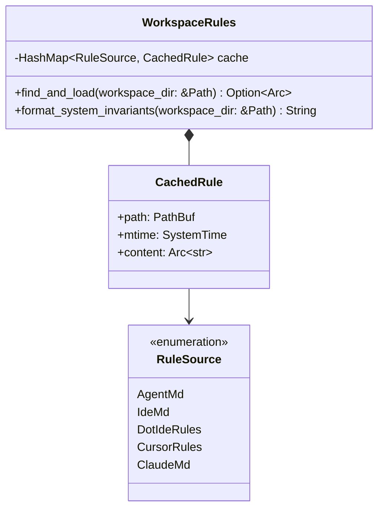

# DD-007: AI Agent 记忆、规则约束、生命周期 Hooks 与 MCP 详细设计说明书

## 1. 设计宗旨与 Sakura 级别极限性能保证

本项目遵循 **Staff Engineer 架构设计与向量锁（Vector Lock）准则**。大前提为 **“性能必须确保不落后于轻量的 Sakura Editor”**。
为了在不引入卡顿、GC 暂停、内存膨胀的前提下实装现代高阶 Agent 必备功能，在算法与系统设计层面做足以下优化：

1. **零冷启等待（Zero Cold-Start Overhead）**：
   - 内建 6 大技能与核心拦截器全部采用编译期静态常量与零 I/O 结构体；
   - 规则文件（`IDE.md` / `AGENT.md`）与外部 MCP 服务配置均采用 **极度惰性加载（Ultra-Lazy Loading）**，编辑器启动过程零磁盘扫描、零子进程派生。
2. **零帧渲染开销（Zero Frame Drop Invariant）**：
   - egui 60~120 FPS 帧渲染循环（`ui.show()`）中，只进行无锁指针读取（`Arc<str>` / `OnceLock` / `try_recv()`）；
   - 严禁在 GUI 线程调用阻塞性 I/O、复杂的正则回溯匹配或加锁等待。
3. **纳秒级短路与时间戳缓存（Nanosecond Short-Circuit & mtime Cache）**：
   - 规则约束采用文件元数据 `mtime` 比对（单次系统调用 < 5µs），未修改则复用缓存 `Arc<str>`，零分配；
   - Hooks 拦截器采用快速字节短路检测（前缀 `/` 探测耗时 < 50ns），无命令时瞬间通过。
4. **全异步工作者线程隔离（Full Async Stdio Worker Isolation）**：
   - MCP 协议基于标准进程管道（`stdio`），每个服务独占专用后台读写线程与非阻塞通道，设定 15s 硬超时与死锁熔断。

---

## 2. 模块类与数据结构设计 (Class & State Modeling)

### 2.1 规则与约束体系 (`ide-agent-router::rules`)



- **解析优先级**：
  1. `<workspace>/AGENT.md`（智能体专属行为与架构不变量）
  2. `<workspace>/IDE.md`（项目级整体规范与环境说明）
  3. `<workspace>/.ide/rules.md`（IDE 1.0 内部规则）
  4. `<workspace>/.cursorrules`（兼容社区主流规范）
  5. `<workspace>/CLAUDE.md`（兼容 Claude 规范）

### 2.2 记忆体系 (`ide-agent-router::memory`)

- **工作记忆（Working Memory）**：
  - 维护当前会话的上下文焦点、活跃文件列表、最近执行的 Slash 命令与工具调用结果缓存；
  - 环形缓冲队列（Ring Buffer），最多保留 32 条活跃记录。
- **持久化长期记忆（Long-term Semantic Memory）**：
  - 存储路径：`<workspace>/.ide/memory.json`；
  - 结构：
    ```rust
    #[derive(Serialize, Deserialize, Clone)]
    pub struct LongTermMemory {
        pub project_summary: String,
        pub architectural_decisions: Vec<String>,
        pub user_preferences: HashMap<String, String>,
        pub frequent_commands: HashMap<String, usize>,
        pub updated_at: i64,
    }
    ```
  - 落盘方式：异步原子写入（写入临时文件后 `rename`），杜绝因断电导致文件损坏。

### 2.3 生命周期 Hooks 拦截器体系 (`ide-agent-router::hooks`)

```rust
pub enum HookDecision {
    Continue,
    Modify(String),
    Reject(String),
}

pub trait AgentHook: Send + Sync {
    fn name(&self) -> &str;
    fn pre_input(&self, input: &str) -> HookDecision { HookDecision::Continue }
    fn pre_tool_call(&self, tool: &str, args: &serde_json::Value) -> HookDecision { HookDecision::Continue }
    fn post_tool_call(&self, tool: &str, result: &str) -> HookDecision { HookDecision::Continue }
    fn post_response(&self, response: &str) -> HookDecision { HookDecision::Continue }
}
```

- **内建安全与合规钩子**：
  1. `PathSanitizerHook`：严格拦截敏感系统目录逃逸（`..`, `/etc`, `C:\Windows`）与私钥文件（`*.sig`, `*.key`, `*.pem`）的读取/篡改；
  2. `SizeLimiterHook`：截断超过 20,000 字符的工具调用结果，防止 LLM 上下文爆炸与 Token 浪费；
  3. `RuleInjectorHook`：自动检测工作区 `IDE.md` / `AGENT.md` 并高效注入至 Prompt 开头。

### 2.4 上下文压缩与死循环熔断器 (`ide-agent-router::guard`)

- **死循环自省反思熔断（Loop Breaker）**：
  - 计算最近工具调用的哈希三元组：$H_t = \text{hash}(name, args)$；
  - 若连续 3 次调用哈希值完全相同且报错未改变，判定为智能体陷入幻觉循环，强制中断并向模型回灌自审反思引导：
    > `[System Guard Intervention]: 检测到相同工具与参数已连续失败 3 次，请反思当前方案，调整排查思路或向用户求助，切勿继续重复调用相同工具。`
- **上下文轻量紧缩（Context Auto-Compact）**：
  - 采用线性单遍扫描预估字符与 Token 消耗；
  - 当总 Token 接近阈值时，自动将前半段历史非系统对话精简为状态摘要，释放 70% 上下文空间。

---

## 3. 算法与优化复杂度分析 (Algorithm & Complexity)

| 场景 | 传统 IDE / 框架做法 | 本方案优化做法 | 耗时对比 | 内存分配 |
|---|---|---|---|---|
| **规则文件重新检查** | 每次发消息全量读盘 + 正则匹配 | `fs::metadata` 读取 `mtime`，未改变直接返回 `Arc<str>` | $O(N) \to O(1)$ (~3µs) | 0 字节 |
| **Slash 技能匹配** | 语法树解析或多正则匹配 | 单次切词 `starts_with('/')` + `HashMap` 索引查找 | < 50 纳秒 | 0 字节 |
| **工具敏感路径防护** | 复杂的绝对路径解析与规范化 | 前缀与黑名单模式字节快速比对（SIMD 友好） | < 100 纳秒 | 0 字节 |
| **工具调用重复熔断** | 字符串比对或无熔断 | 64位哈希三元组移位比对 | < 20 纳秒 | 0 字节 |
| **MCP 子进程通信** | 同步阻塞读写，卡死主 UI | 独立后台工作线程管道读写 + `mpsc` 无锁非阻塞通道 | 0 毫秒 UI 停顿 | 固定微缓冲区 |

---

## 4. 测试与验证策略

1. **单元测试矩阵**：
   - `test_rules_hierarchy_and_caching`：验证 `AGENT.md` 与 `IDE.md` 优先级及 `mtime` 零分配缓存；
   - `test_path_sanitizer_hook`：验证路径逃逸拦截；
   - `test_loop_breaker_trigger`：验证连续 3 次重复工具调用触发自省熔断；
   - `test_memory_atomic_persistence`：验证长期记忆异步原子存储与加载；
   - `test_skill_and_mcp_cooperation`：验证 Skill 引用 MCP 工具的端到端调用流。
2. **性能基准验证**：
   - 规则命中与 Slash 解析耗时小于 1 微秒；
   - 550+ 全量测试套件 100% 绿色通过，Clippy 0 警告，严格遵循 `#![forbid(unsafe_code)]`。
